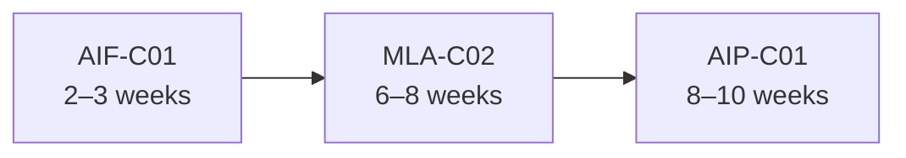

# AWS AI Certification Curriculum 2027

Ordered study path for preparing and taking these three AWS AI certifications.

| | |
|---|---|
| **This site** | [https://adron.github.io/curriculum-2027/](https://adron.github.io/curriculum-2027/) |
| **Repo README** | [README.md](https://github.com/Adron/curriculum-2027/blob/main/README.md) |
| **GitHub repository** | [Adron/curriculum-2027](https://github.com/Adron/curriculum-2027) |

**Do not skip the order.** AIF → MLA → AIP stacks concepts: vocabulary → pipelines → production GenAI.

## The three certifications

| Priority | Certification | Exam | Level | Study pack |
|---|---|---|---|---|
| 1 | AWS Certified AI Practitioner | AIF-C01 | Foundational | [Folder](AIF-C01-AWS-Certified-AI-Practitioner/) · [Workbooks](AIF-C01-AWS-Certified-AI-Practitioner/workbooks/) |
| 2 | AWS Certified Machine Learning Engineer – Associate | MLA-C02 | Associate | [Folder](MLA-C02-AWS-Certified-Machine-Learning-Engineer-Associate/) · [Workbooks](MLA-C02-AWS-Certified-Machine-Learning-Engineer-Associate/workbooks/) |
| 3 | AWS Certified Generative AI Developer – Professional | AIP-C01 | Professional | [Folder](AIP-C01-AWS-Certified-Generative-AI-Developer-Professional/) · [Workbooks](AIP-C01-AWS-Certified-Generative-AI-Developer-Professional/workbooks/) |

## Recommended path

| Phase | Cert | Suggested duration | Exit criteria |
|---|---|---|---|
| 1 | [AIF-C01](AIF-C01-AWS-Certified-AI-Practitioner/) | 2–3 weeks | Practice exam ≥80%; explain FM vs traditional ML, RAG, responsible AI, core AWS AI services |
| 2 | [MLA-C02](MLA-C02-AWS-Certified-Machine-Learning-Engineer-Associate/) | 6–8 weeks | Prepare data, train/tune, deploy, and monitor ML + FM on SageMaker/Bedrock |
| 3 | [AIP-C01](AIP-C01-AWS-Certified-Generative-AI-Developer-Professional/) | 8–10 weeks | Design, secure, optimize, and troubleshoot production GenAI (RAG, agents, evals) |

Rough calendar: **~4–5 months** at 5–8 hrs/week. Compress Phase 1 if you already know GenAI vocabulary; do not compress Phase 3.

## How to study each cert

For every certification folder:

1. Read the folder **README** and exam snapshot  
2. Work the **punch list** topic notes  
3. Complete the **workbooks** (active recall, scenarios, hands-on, mastery checks)  
4. Take official Skill Builder practice → schedule only at ≥80%

### Phase 1 — AI Practitioner (AIF-C01)

- [Study pack README](AIF-C01-AWS-Certified-AI-Practitioner/)
- [Punch list](AIF-C01-AWS-Certified-AI-Practitioner/PUNCH-LIST.md)
- [Workbooks](AIF-C01-AWS-Certified-AI-Practitioner/workbooks/)
- Official: [AI Practitioner](https://aws.amazon.com/certification/certified-ai-practitioner/) · [Exam guide PDF](https://docs.aws.amazon.com/pdfs/aws-certification/latest/ai-practitioner-01/ai-practitioner-01.pdf)

### Phase 2 — ML Engineer Associate (MLA-C02)

- [Study pack README](MLA-C02-AWS-Certified-Machine-Learning-Engineer-Associate/)
- [Punch list](MLA-C02-AWS-Certified-Machine-Learning-Engineer-Associate/PUNCH-LIST.md)
- [Workbooks](MLA-C02-AWS-Certified-Machine-Learning-Engineer-Associate/workbooks/)
- Official: [ML Engineer – Associate](https://aws.amazon.com/certification/certified-machine-learning-engineer-associate/) · [Exam guide PDF](https://docs.aws.amazon.com/pdfs/aws-certification/latest/machine-learning-engineer-associate-02/machine-learning-engineer-associate-02.pdf)

### Phase 3 — Generative AI Developer Professional (AIP-C01)

- [Study pack README](AIP-C01-AWS-Certified-Generative-AI-Developer-Professional/)
- [Punch list](AIP-C01-AWS-Certified-Generative-AI-Developer-Professional/PUNCH-LIST.md)
- [Workbooks](AIP-C01-AWS-Certified-Generative-AI-Developer-Professional/workbooks/)
- Official: [GenAI Developer – Professional](https://aws.amazon.com/certification/certified-generative-ai-developer-professional/) · [Exam guide PDF](https://docs.aws.amazon.com/pdfs/aws-certification/latest/ai-professional-01/ai-professional-01.pdf)

## Cross-cutting habits

- **Official sources first:** exam guides + Skill Builder prep plans + official practice exams  
- **Hands-on after AIF:** Console + IaC for MLA and AIP  
- **Recertification:** each cert lasts 3 years; passing MLA auto-recertifies AIF  
- **Booking:** Pearson VUE — schedule after the practice-exam threshold, not after “finishing the course”

## Source curriculum

- Full narrative curriculum: [curriculum.md](curriculum.md)
- Repo README: [README.md](https://github.com/Adron/curriculum-2027/blob/main/README.md)
- Repository: [https://github.com/Adron/curriculum-2027](https://github.com/Adron/curriculum-2027)
- Rendered site (this page): [https://adron.github.io/curriculum-2027/](https://adron.github.io/curriculum-2027/)
